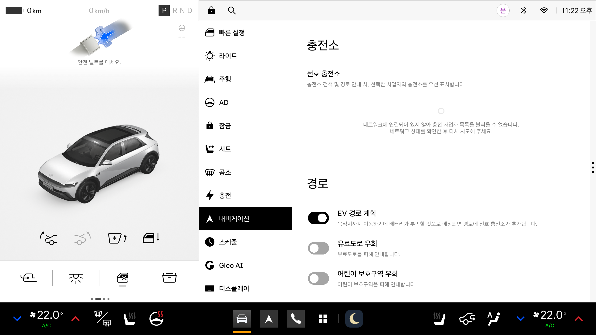
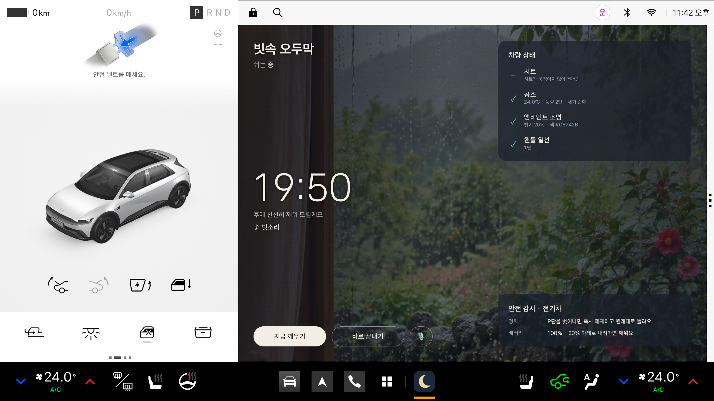

# 차분 (Chabun)

정차 중 버튼 하나로 시트, 공조, 조명, 창문, 사운드를 바꿔 차 안을 쉬는 공간으로 만드는 Pleos Connect 앱입니다.

현대자동차그룹 차량용 앱 개발 공모전 출품작입니다. 공개 저장소이며 소스 코드와 release APK가 함께 들어 있습니다.

| 제출 안내 항목 | 위치 |
|---|---|
| 앱 이름 및 한 줄 소개 | 이 문단 |
| 실행 방법 | [실행 방법](#실행-방법) |
| 테스트 환경 및 필요한 설정 | [테스트 환경](#테스트-환경), [필요한 설정](#필요한-설정) |
| APK 파일 위치 | [`apk/한동훈_차분_release.apk`](apk/한동훈_차분_release.apk), [GitHub Release v0.1.0](https://github.com/han6732-oss/chabun/releases/tag/v0.1.0) |

| 홈 | 휴식 중 |
|---|---|
|  |  |

## 주요 기능

- **공간 컨셉 장면**: 비행기 기내, 우주 유영, 빗속 오두막, 새벽 숲. 장면마다 시트 각도, 공조, 조명, 창문, 앰비언트 사운드가 정해져 있고, 직접 고치거나 새로 만들어 저장할 수 있습니다.
- **시간 고르기**: 장면을 누르면 시간(프리셋, 직접 정하기, 직접 끝내기, 충전 끝날 무렵 깨우기, 1분 체험)을 고르는 즉시 시작합니다.
- **말로 하기**: "우주 유영 켜줘", "빗소리로 이십 분만 쉴래", "깨워줘", "차분 꺼줘"처럼 말로 시작하고 끝냅니다(Pleos 음성 인식 ON_DEVICE).
- **안전 감시**: 엔진차는 10분마다 90초 환기하고 최대 60분까지 쉽니다. 전기차는 배터리가 20% 아래로 내려가면 깨웁니다.
- **충전 대기**: 충전이 끝날 무렵이나 정한 충전량에 닿으면 깨웁니다.
- **기상 후 경로 안내**: 내비 안내 중이면 깨울 때 남은 거리와 시간을 알려 줍니다.
- **브랜드관**: 가상 항공사 ORVEL AIR 퍼스트 클래스, 가상 호텔 HOTEL MAPLINE 스위트(시연용 가상 브랜드).
- **다국어**: 한국어(기본), 영어, 일본어, 중국어.

## APK

- **저장소 안 위치**: [`apk/한동훈_차분_release.apk`](apk/한동훈_차분_release.apk)
- **GitHub Release**: https://github.com/han6732-oss/chabun/releases/tag/v0.1.0 (같은 파일입니다. GitHub가 파일 이름의 한글을 바꿔, Release에서 내려받으면 `_._release.apk`로 저장됩니다.)
- **빌드**: release 빌드, 버전 0.1.0, 약 54MB, Android 디버그 키로 서명
- **패키지**: `com.chabun.app` (minSdk 28, targetSdk 34)

## 테스트 환경

| 항목 | 내용 |
|---|---|
| 에뮬레이터 | Pleos Connect v2.1.0 (`system-images;android-34;pleos_car_emulator;x86_64`) |
| SDK Update Site | https://nexus-playground.pleos.ai/repository/raw-releases/connect-avd/2.x/crp-sys-img.xml |
| AVD | RAM 4GB, **Cold boot** (Quick boot로 켜면 차량 기능이 동작하지 않습니다) |
| 차량 | 에뮬레이터 기본 차량(전기차) |
| 개발 도구 | Android Studio 2025.3, JDK 17, Gradle 8.13, AGP 8.8.2, Kotlin 2.0.21, Compose BOM 2024.12.01 |
| Pleos SDK | Vehicle 2.3.2, TextToSpeech 3.3.1, SpeechToText 3.3.1, NaviHelper 3.0.5, FusedLocation 1.1.3 |
| 차량 표준 데이터 | 기어, 속도, 연료 종류, 충전 상태는 AAOS Car API(`android.car`)로 읽습니다 |

## 실행 방법

1. 에뮬레이터를 Cold boot로 켭니다.
   ```bash
   emulator -avd <AVD 이름> -no-snapshot
   ```
2. 저장소를 받아 APK를 설치하고 실행합니다(Release에서 받았다면 그 파일 경로로 바꿉니다). 런처의 앱 목록에서 '차분'을 눌러도 됩니다. 앱은 홈 화면 오른쪽 앱 영역에 열립니다.
   ```bash
   git clone https://github.com/han6732-oss/chabun.git
   cd chabun
   adb install -r apk/한동훈_차분_release.apk
   adb shell am start -n com.chabun.app/.MainActivity
   ```
3. Virtual Console에서 기어를 P에 둡니다(아래 '필요한 설정'). 장면은 P단에서만 시작됩니다.
4. 장면 카드를 누르고 시간을 고르면 바로 시작합니다. 휴식 화면의 '끝내기'로 끝냅니다.

## 필요한 설정

에뮬레이터의 차량 상태는 Virtual Console에서 바꿉니다.

```bash
adb forward tcp:8088 tcp:8088
```

브라우저에서 http://127.0.0.1:8088/ 을 엽니다(로그인 없음).

- **기어 P**: 상단의 Park 버튼을 누릅니다.
- **공조 전원**: CLIMATE > Power를 켭니다. 에뮬레이터는 앱이나 Pleos 화면에서 공조 전원을 켤 수 없어, 켜 두어야 풍량과 온도 변화가 보입니다.

### 기능별 시연

- **충전 대기**: Energy에서 Charge Percent Limit을 80, Battery SOC를 70 근처로 둔 뒤, 시간 고르기에서 '충전 끝날 무렵 깨우기'로 시작합니다. SOC 슬라이더를 1%씩(키보드 →) 간격을 두고 올리면 진행 상황과 예상 시간이 나오고 79%에서 깨웁니다. 에뮬레이터는 실제 충전을 시뮬레이션하지 않아 이렇게 올려 줘야 합니다. 처음 시작할 때 충전 정보 권한을 묻습니다.
- **전기차 배터리 하한**: 쉬는 중에 Battery SOC를 20% 아래로 내리면 깨웁니다.
- **엔진차 안전 감시**: 설정 > 차량 종류에서 '엔진차로 체험'을 고르고 '시연용 짧은 주기'를 켜면 환기가 1분마다 15초, 최대 휴식이 5분으로 짧아집니다(에뮬레이터 차량은 전기차입니다).
- **기상 후 경로 안내**: 내비 앱에서 목적지 안내를 시작해 둔 뒤 장면을 끝내면 남은 거리와 시간을 말해 줍니다. 내비 앱을 처음 열 때 "실행이 지연되고 있습니다"가 나오면 다시 시도합니다.
- **말로 하기**: 홈의 '말로 하기'를 누르고 한국어로 말합니다. 에뮬레이터에서는 Extended controls > Microphone에서 'Virtual microphone uses host audio input'을 켜야 PC 마이크가 들어갑니다. 음성 명령은 화면 언어와 상관없이 한국어로 해석합니다.
- **언어와 화면**: 설정 > 언어에서 영어, 일본어, 중국어로 바꿀 수 있습니다. 차량 음성 안내(TTS)가 한국어와 영어만 지원해 일본어와 중국어는 화면 알림으로만 안내합니다. 설정 > 화면에서 '시스템 주야간 설정 따르기'를 고르면 주간에는 밝은 화면으로 바뀝니다.

## 소스에서 빌드

```bash
./gradlew :app:assembleRelease
```

결과물은 `app/build/outputs/apk/release/app-release.apk`입니다. Pleos SDK는 Pleos Playground Maven 저장소(https://nexus-playground.pleos.ai/repository/maven-releases/)에서 별도 인증 없이 받습니다. Android SDK 경로는 `local.properties`(Android Studio가 자동 생성) 또는 `ANDROID_HOME`으로 지정합니다.

단위 테스트:

```bash
./gradlew :app:testDebugUnitTest
```

## 저장소 구성

| 경로 | 내용 |
|---|---|
| `apk/` | 제출용 release APK |
| `app/` | 앱 소스(Kotlin, Jetpack Compose) |
| `docs/` | 기능별 화면 캡처 |
| `assets/`, `이미지/` | 장면 이미지 원본과 생성 프롬프트 |
| `tools/make_ambience.sh` | 앰비언트 음원을 반복 재생용으로 자르고 음량을 맞추는 스크립트 |
